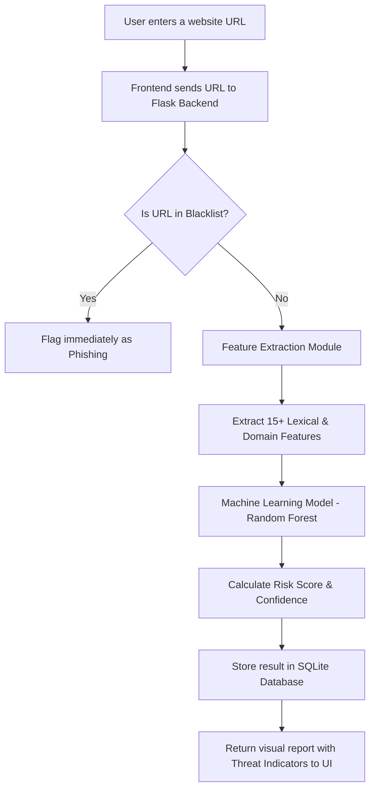

# Complete Project Documentation: Phishing Website Detection System

---

## 1. What is This Project?
The **Phishing Website Detection System** is an intelligent web application built using **Python, Flask, and Machine Learning**. Its primary purpose is to protect users from cyber attacks by analyzing website URLs in real time and determining whether they are **Legitimate (Safe)** or **Phishing (Dangerous/Fraudulent)**.

---

## 2. How Does It Work? (End-to-End Workflow)



### Step-by-Step Flow:
1. **User Input:** A user pastes a suspicious website link into the search bar.
2. **Blacklist Check:** The backend instantly checks if the URL has been previously reported or blacklisted.
3. **Feature Extraction:** If not blacklisted, the URL is broken down and analyzed across multiple characteristics (length, special characters, suspicious keywords, domain age, IP address usage, etc.).
4. **ML Prediction:** The extracted features are fed into a pre-trained **Random Forest Classifier** which calculates the likelihood of phishing.
5. **Report & History:** The application calculates a **Risk Score (0–100%)**, saves the scan record to a local database for tracking, and displays a breakdown to the user.

---

## 3. Frontend (User Interface)

### Technologies Used:
- **HTML5:** Semantic layout for web pages.
- **CSS3:** Custom styling with modern **Glassmorphism**, dark mode accents, animated threat meters, and responsive layouts.
- **JavaScript (Vanilla JS):** Handles client-side form submissions, asynchronous API calls (`fetch`), animated confidence score counters, and dynamic DOM updates without full-page reloads.

### Pages & Capabilities:
- **Home / Scanner Page (`index.html`):** Clean search interface with real-time scan feedback, threat level indicators, and safety recommendations.
- **User Dashboard (`dashboard.html`):** Allows users to view their scan history and track flagged URLs.
- **Admin Dashboard (`admin.html`):** Management interface for administrators to view system statistics, monitor all user scans, and manage blacklisted URLs.
- **Authentication Pages (`login.html`, `register.html`):** Secure login, signup, and session management.
- **Report Page (`report.html`):** Community reporting tool allowing users to report suspicious URLs directly.

---

## 4. Backend (Server & Database)

### Technologies Used:
- **Python 3**: Core programming language.
- **Flask Framework**: Lightweight WSGI web framework providing routing, template rendering (Jinja2), and REST API endpoints.
- **SQLite3 Database (`database.py`)**: Embedded relational database managing:
  - User accounts (with password hashing).
  - Scan history (URL, result, confidence, risk score, timestamp).
  - Blacklist & user reports.
- **Joblib**: Loads the pre-trained machine learning model into memory during server startup.

### Core Modules:
- **`app.py`**: The central controller defining all web routes, session authentication, and API endpoints (e.g., `/scan`, `/report`, `/admin`).
- **`database.py`**: Handles database connections, queries, schema migrations, and user management.
- **`feature_extraction.py`**: Transforms any raw URL string into numerical vectors and threat explanations suitable for ML input.

---

## 5. Machine Learning (ML): Why and How It Is Used

### Why Machine Learning?
Traditional phishing detection relies on **static blacklists** (lists of known bad sites). However, attackers create thousands of new phishing domains every hour (known as *Zero-Day Phishing*). Static lists fail to catch these new sites. 

**Machine Learning solves this** by learning the hidden patterns, structural signatures, and behavioral cues that distinguish phishing URLs from legitimate ones.

### Features Extracted from URLs:
The feature extraction module extracts over 15 distinct signals:
1. **URL Length:** Phishing URLs are often unusually long to hide the true destination.
2. **Presence of IP Address:** Legitimate domains use DNS names (e.g., `google.com`), whereas phishers sometimes use raw IP addresses (e.g., `http://192.168.1.1/login`).
3. **Use of `@` Symbol:** When `@` is present in a URL, browsers often ignore everything before it.
4. **Hyphens in Domain:** Phishers use hyphens (e.g., `paypal-security-update.com`) to impersonate real brands.
5. **Number of Subdomains:** Multi-level subdomains (e.g., `secure.login.banking.evil.com`) are common in phishing.
6. **HTTPS / SSL Protocol:** Validates whether the protocol is secure.
7. **Suspicious Keywords:** Checks for trigger words like `login`, `verify`, `update`, `banking`, `secure`, `account`.
8. **Shortening Services:** Identifies bit.ly, tinyurl, etc., which obscure real destination URLs.
9. **Domain Age (WHOIS):** Phishing domains are often registered only days or weeks prior to an attack.

### Model Used: Random Forest Classifier
- **Why Random Forest?**
  - High classification accuracy.
  - Combines multiple decision trees (ensemble learning), reducing the chance of overfitting.
  - Generates probability scores for risk assessment.
  - Operates in milliseconds, enabling real-time detection without slowing down browsing.

---

## 6. How to Run & Use the Project

### Prerequisites:
Make sure you have **Python 3.8+** installed.

### Step 1: Install Dependencies
```bash
pip install -r requirements.txt
```

### Step 2: (Optional) Retrain the ML Model
If you modify training data or wish to re-train:
```bash
python notebooks/train_model.py
```
*(This will generate or update `models/phishing_rf_model.pkl`)*

### Step 3: Run the Web Application
```bash
cd app
python app.py
```

### Step 4: Open in Your Browser
Visit: **`http://127.0.0.1:5000`** in your web browser.
